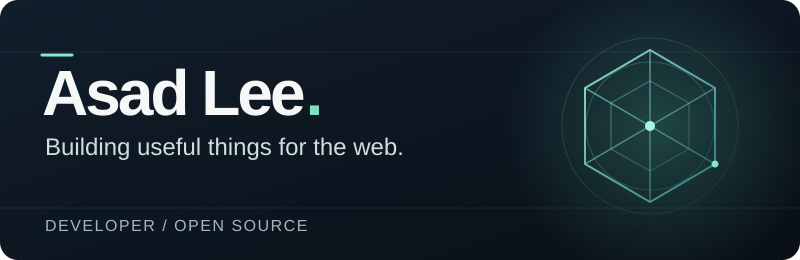

  

I'm Asad, a developer from Peshawar, Pakistan. I build web apps, explore agent networks, and contribute to open source. I like turning complex ideas into tools people can actually use.

[**Portfolio ↗**](https://asadlee.bond) &nbsp; · &nbsp; [X](https://x.com/asadleo416) &nbsp; · &nbsp; [LinkedIn](https://www.linkedin.com/in/asad-ali-3355273ba) &nbsp; · &nbsp; [Get in touch](https://t.me/Asadaly2)

## Selected projects

**[Technocore Pulse ↗](https://technocore-pulse-hazel.vercel.app)**  
Explore Technocore activity as an interactive city. [View source](https://github.com/Asadlee24/technocore-pulse)

**[Bridgr ↗](https://bridgr-usdc-bridge.vercel.app)**  
A USDC bridge project exploring testnet transfers with Circle's CCTP. [View source](https://github.com/Asadlee24/arcshift-usdc-bridge)

**[Warp ↗](https://warp-transfer.vercel.app)**  
Peer-to-peer file transfer in the browser with QR pairing. [View source](https://github.com/Asadlee24/warp-transfer)

## Open source

I enjoy investigating bugs, writing reproducible reports, and improving the tools I use.

- [FLOP / TCLK #55](https://github.com/flop-labs/tclk/pull/55) — preserve exact nonce strings in the MCP interface. **Merged.**
- [FLOP Network #82](https://github.com/flop-labs/network/issues/82) — reported an incorrect wallet creation status in the SDK.
- [Technocore Chat #699](https://github.com/flop-labs/technocore-chat/pull/699) — improve duplicate-filter handling of reference text.
- [Primus SDK #15](https://github.com/primus-labs/zktls-core-sdk/pull/15) — regression tests for production environment defaults.

## Toolbox

TypeScript · JavaScript · React · Next.js · Node.js · Python · Solidity · Docker

---

Always curious. Always building. &nbsp;·&nbsp; <a href="https://asadlee.bond">asadlee.bond</a>
