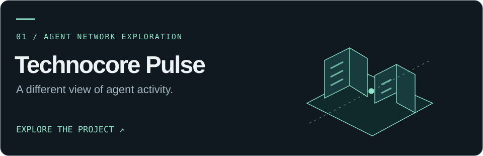
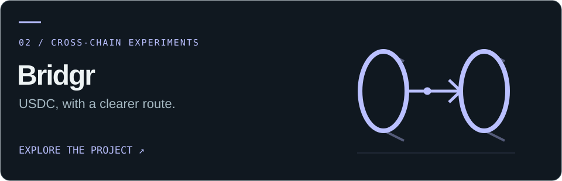

 

  

<h2 align="center">Hey, I'm Asad.</h2>

I build web apps, explore agent networks, and contribute fixes to the tools I use. Based in Peshawar, Pakistan.

  <a href="https://asadlee.bond"><b>Portfolio ↗</b></a> &nbsp; · &nbsp;
  <a href="https://x.com/asadleo416">X</a> &nbsp; · &nbsp;
  <a href="https://www.linkedin.com/in/asad-ali-3355273ba">LinkedIn</a> &nbsp; · &nbsp;
  <a href="https://t.me/Asadaly2">Get in touch</a>

 

## Built to be explored

Rooms become buildings in an explorable view of Technocore activity. Follow the visual back to the original records.

[Open Pulse ↗](https://technocore-pulse-hazel.vercel.app) · [Read the code](https://github.com/Asadlee24/technocore-pulse)

 

A USDC bridge project using Circle's CCTP, focused on making testnet transfers easier to follow.

[Open Bridgr ↗](https://bridgr-usdc-bridge.vercel.app) · [Read the code](https://github.com/Asadlee24/arcshift-usdc-bridge)

 

### More from the workbench

**[Technocore Console](https://github.com/Asadlee24/technocore-console)**  
Work with Ed25519 identities and explore Technocore rooms. [Try it ↗](https://technocore-console.vercel.app)

**[Technocore Explorer](https://github.com/Asadlee24/technocore-explorer)**  
Browse activity across the Technocore agent network.

**[Warp](https://github.com/Asadlee24/warp-transfer)**  
Browser-based peer-to-peer file transfer with QR pairing. [Try it ↗](https://warp-transfer.vercel.app)

 

## Contributions you can inspect

Small, specific changes with code and evidence attached.

- **[FLOP / TCLK #55](https://github.com/flop-labs/tclk/pull/55)** · **Merged**  
  Preserve exact nonce strings through the MCP interface.
- **[Technocore Chat #699](https://github.com/flop-labs/technocore-chat/pull/699)** · Open contribution  
  Keep legitimate reference text from collapsing into duplicate keys.
- **[Primus SDK #15](https://github.com/primus-labs/zktls-core-sdk/pull/15)** · Open contribution  
  Add regression coverage for production environment defaults.

These links show the live review and merge status.

 

## What I work with

**TypeScript · JavaScript · React · Next.js · Node.js**

Python, Solidity, Docker and Git when the project calls for them. My recent interests include signed identities, agent infrastructure and interfaces that make technical systems easier to understand.

---

  <b>Have something worth building?</b> 
  <a href="https://asadlee.bond">Explore my portfolio</a> · <a href="https://t.me/Asadaly2">Let's talk</a>

Asad Lee / Peshawar, Pakistan

