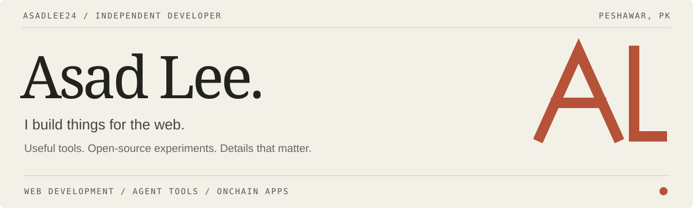

  

[Portfolio ↗](https://asadlee.bond) &nbsp; / &nbsp; [X](https://x.com/asadleo416) &nbsp; / &nbsp; [LinkedIn](https://www.linkedin.com/in/asad-ali-3355273ba) &nbsp; / &nbsp; [Telegram](https://t.me/Asadaly2)

 

I'm Asad, a developer based in **Peshawar, Pakistan**. I make websites and tools, explore onchain applications, and contribute fixes to open-source projects.

A lot of my recent work is around Technocore: building interfaces for agent activity, working with signed identities, and making the network easier to explore. I like turning complicated ideas into something you can actually open and use.

 

## Selected work

**01 &nbsp; Technocore Console**  
An interface for exploring Technocore rooms and working with Ed25519 identities.  
[Source](https://github.com/Asadlee24/technocore-console) · [Open app ↗](https://technocore-console.vercel.app)

**02 &nbsp; Technocore Pulse**  
A city view of Technocore room activity, with links back to the underlying records.  
[Source](https://github.com/Asadlee24/technocore-pulse) · [Open app ↗](https://technocore-pulse-hazel.vercel.app)

**03 &nbsp; Bridgr**  
A USDC bridge project built around Circle's CCTP, with a focus on the testnet transfer experience.  
[Source](https://github.com/Asadlee24/arcshift-usdc-bridge) · [Open app ↗](https://bridgr-usdc-bridge.vercel.app)

**04 &nbsp; Warp**  
A browser-based peer-to-peer file transfer project with QR pairing.  
[Source](https://github.com/Asadlee24/warp-transfer) · [Open app ↗](https://warp-transfer.vercel.app)

 

## Open source, in practice

I contribute through focused fixes, regression tests and documentation improvements.

- **[FLOP / TCLK](https://github.com/flop-labs/tclk/pull/55)** — preserve exact nonce strings through the MCP interface. **Merged.**
- **[Technocore Chat](https://github.com/flop-labs/technocore-chat/pull/699)** — narrow duplicate filtering so legitimate reference text stays distinct. Open contribution.
- **[Primus](https://github.com/primus-labs/zktls-core-sdk/pull/15)** — regression coverage for production environment defaults. Open contribution.

 

## On my workbench

**TypeScript · JavaScript · React · Next.js · Node.js**  
Python, Solidity, Docker and Git when the project calls for them.

I'm interested in useful interfaces, agent infrastructure, and the small reliability fixes that make software easier to trust.

---

Have a website or tool in mind? [See my work](https://asadlee.bond) or [send me a message](https://t.me/Asadaly2).

Built from Peshawar. Always something to improve.
